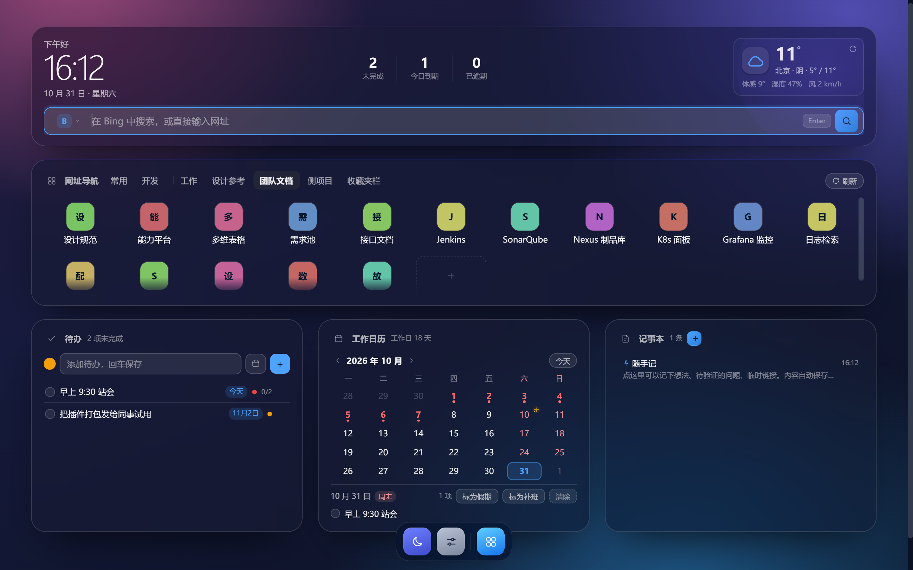

# edge-nav · 自定义新标签页扩展

Manifest V3 + Vue 3 + Vite。核心是一块**像素级自由拖拽的卡片画布**：卡片任意摆放、自由缩放、互相挤开；网址导航可直接**按浏览器书签文件夹分类展示**，配深浅双主题与两套视觉风格、自动更新的工作日历与记事本。


深色主题：

## 1. 快速开始

### 方式 A：下载现成包（无需构建）

从本仓库的 Releases 页面下载 `edge-nav-vX.Y.Z.zip`，解压到任意目录（解压后应直接看到 `manifest.json`），再按下方步骤加载解压目录。

### 方式 B：从源码构建

```bash
npm install
npm run build        # 产物输出到 dist/
```

浏览器加载：`edge://extensions` → 开启「开发人员模式」→「加载解压缩的扩展」→ 选 **`dist`** → 新建标签页。

开发命令：`npm run dev`（网页预览）· `npm run watch`（增量构建）· `npm run typecheck` · `npm run icons` · `npm run check:version`

> Chrome 137+ 已移除 `--load-extension`，命令行无法加载未打包扩展，只能在扩展页手动加载。

## 2. 功能

| 模块 | 说明 |
|---|---|
| 时钟天气 | 时钟、问候、日期与天气合并为一张概览卡，底部内嵌搜索框 |
| 搜索 | 5 个引擎切换、网址直连（输入 `github.com` 直接跳转）；**结果一律在新标签页打开** |
| 网址导航 | **书签文件夹标签页**（内容实时读浏览器书签）+ 本地分组，可勾选展示哪些文件夹；双击改名、拖拽排序、一键拍平导入 |
| 书签增改 | 在书签文件夹里点「添加」→ 勾选「同时保存到浏览器书签」即写回书签；不勾选则只进导航（之后可点 ↑ 补写） |
| 打开方式 | 磁贴与搜索都在**新标签页**打开，当前这块新标签页保留，方便连续打开多个站点 |
| 视觉风格 | `apple` / `win11` 两套材质与圆角，与深浅色相互独立，可两两组合 |
| 主题 | 浅色 / 深色 / 跟随系统，切换即时生效，跟随系统时响应系统设置变化 |
| 大屏适配 | 等比放大到能放下为止，再把剩余宽度摊给卡片；4 档视口实测内容占屏 96%~98% |
| 布局 | 任意拖拽、右下角自由缩放、20px 吸附、碰撞自动挤开、窄屏流式降级 |
| 壁纸 | 6 套渐变（深色下自动压暗）、本地上传（自动压缩）、模糊与遮罩强度 |
| 待办 | 优先级、截止日期、子任务、过期标红、已完成清理 |
| 工作日历 | 月视图、**周末/节假日/调休补班三类标识**、当月工作日统计、单日手动标记 |
| 记事本 | 随手记：新建、编辑、置顶、删除、自动保存、首行作标题 |
| 数据 | JSON 导出/导入、书签导入、恢复默认、一键重排卡片 |

## 3. 大屏自适应怎么算的

内容按「设计宽度 1120px」存坐标，渲染时做两步换算，两段互不干扰：

1. **整体等比缩放** `scale = min(可用高度 / 布局高度, 容器宽 / 1120, 1.6)` —— 先保证纵向放得下，同时吃掉一部分横向空间，字号跟着变大；
2. **横向伸展** `stretch = 容器宽 / (1120 × scale)`（上限 1.6）—— 等比缩放后剩下的横向余量摊给卡片宽度，**只拉宽不拉高，字号不变**。

实测（内容占屏）：

| 视口 | 缩放 | 占屏 | 滚动 |
|---|---|---|---|
| 1366×768 | 0.87 | 96% × 86% | 无 |
| 1440×900 | 1.04 | 97% × 88% | 无 |
| 1920×1080 | 1.27 | 98% × 89% | 无 |
| 2560×1440 | 1.60 | 88% × 84% | 无 |

几个关键取舍：

- 缩放基准高度取**默认布局高度**（760）而不是当前内容高度 —— 否则把卡片往下拖，整页会越拖越小；
- 卡片拖到更矮会撑高页面时，宁可纵向滚动，也不继续缩；
- 左右边距跟视口走：`clamp(18px, 3.4vw, 76px)`，宽度上限 2120px。实测边距 1366→47px、1440→49px、1920→66px、2560→220px，小屏不贴边、大屏不顶满。

## 4. 书签文件夹导航

浏览器书签栏里的文件夹（例如 `工作` / `设计参考` / `团队文档` / `侧项目`）会被扫描成导航标签页：

- **扫描**：遍历 `chrome.bookmarks.getTree()`，只收录「含直属网址」的文件夹，父文件夹与子文件夹不会重复；收藏夹栏根节点排在最后，首次进入默认选中第一个分类文件夹。
- **可配置**：设置 →「书签文件夹导航」勾选要显示的文件夹，最多默认展示 8 个。
- **移除不影响书签**：标签页上的 ✕、单条链接上的 ✕，都只写本地 `config.bookmarks.hidden` / `enabled`，**代码里从不调用 `bookmarks.remove`**；随时可在设置里恢复。
- **添加即同步**：对话框里默认勾选「同时保存到浏览器书签」，确认后调 `bookmarks.create({ parentId })` 写进对应文件夹，导航与书签栏同时出现；取消勾选则进 `config.bookmarks.extras`，只存在导航里，之后可点 ↑ 补写。

导航的视觉规则（解决「挤成一团、没有层次」）：

- 标签栏只写名字，条数放进 `title` 悬停提示；选中态是实心强调色胶囊，本地分组与书签文件夹之间有一条竖分隔线
- 磁贴固定 96px 列宽并整行居中；图标 34px 圆角底 + 细描边，标题单行省略，hover 整块浮起（描边 + 阴影 + 上移 1px）
- 网格高度不足 2 行时：内容垂直居中；溢出时按行吸附滚动，底部渐隐提示「还有内容」，不会露出半个磁贴
- 网址导航卡片默认高度 220（够放 2 行磁贴）。老配置加载时会自动抬到 220，并把被顶住的卡片依次下推

## 5. 数据存哪里（会不会丢）

所有数据存在**本机浏览器**的扩展存储里，不上传任何服务器：

| 项 | 位置 | 说明 |
|---|---|---|
| 全部配置 | `chrome.storage.local` → 键 `edge-nav:config` | 链接、书签文件夹开关、隐藏记录、待办、笔记、日历标记、布局坐标、主题、壁纸 |
| 壁纸大图 | 同上（已申请 `unlimitedStorage`） | 上传时压到最长边 2560px、≤1.5MB |
| 天气缓存 | 同上 → 键 `edge-nav:weather-cache` | 20 分钟有效，离线时用它兜底 |
| 节假日缓存 | 同上 → 键 `edge-nav:holidays` | 按年存，7 天有效，离线时用它兜底 |
| 写入时机 | 任意改动后 200ms 防抖落盘 | 输入、拖拽、缩放都不会丢 |

**不会丢**：关标签页、重启浏览器、重启电脑、清浏览历史（扩展存储不随清缓存删除）。
**会丢**：卸载扩展、删除 `dist` 目录、更换加载路径（未打包扩展的 ID 由绝对路径决定，路径变了就等于新扩展，读不到旧数据）。
**抗风险**：设置 →「导出配置」生成 JSON，换机或误删后可「导入配置」完整还原。

书签本体在浏览器里，扩展只读/按需写；导出的 JSON 只含「显示哪些文件夹」这类开关，不含书签内容本身。

## 6. 离线可用性

除天气与节假日更新外，全部功能离线可用：

- 链接跳转、搜索、待办、记事本、日历、布局、壁纸：纯本地
- 站点图标走浏览器内置 `_favicon` 接口，命中本地缓存，不走第三方服务
- 天气：优先展示 20 分钟缓存，无网时显示上次数据并提示「离线，显示上次数据」
- 节假日：优先在线数据，无网读 7 天缓存，连缓存都没有则回落到内置 13 天法定假日

## 7. 节假日口径（重要）

| 层级 | 来源 | 优先级 |
|---|---|---|
| 1 | 用户手动标记（`config.calendar.overrides`） | 最高 |
| 2 | 在线数据：`holiday-cn`（按国务院办公厅通知维护，含法定假日 + 连休 + 补班） | 高 |
| 3 | 内置法定节假日 13 天（`src/data/holidays.ts`） | 兜底 |
| 4 | 周末推算 | 最低 |

- 数据源：`https://cdn.jsdelivr.net/gh/NateScarlet/holiday-cn@master/<年>.json`，依次尝试 `fastly` / `gcore` / `cdn` 三个 jsDelivr 域名，任一成功即用。
- 缓存 7 天；成功拉取后不再重复请求。设置 →「节假日数据」可看状态与上次更新时间，也可「立即更新」。
- 表头「工作日 N 天」按合并后的结果实时计算（2026 年 10 月扣除国庆 7 天、加回 10-10 补班 = 18 天）。

## 8. 布局引擎

- 坐标存 `x / y / w / h`，全部吸附到 20 的整数倍（默认布局也在网格上）
- 拖拽：`pointerdown` 在卡片空白处 → window 监听 `pointermove`，位移分别除以 `unitX`（横向，含伸展）与 `unitY`（纵向，仅缩放）后 `snap()`
- 缩放：右下角圆点独立 `pointerdown` 且 `stopPropagation`，最小 200×120
- 挤开：被拖卡片最高优先级，其余按 `y→x` 顺序下移到「被占卡片底边 + 间距」，级联至不重叠
- 判定间隙：矩形外扩 `GAP/2`，保证挤开后间距恰好 20px
- 窄屏：< 720px 切换流式单列（禁用绝对定位与伸展）；720~1120 走等比缩小；> 1120 追加横向伸展

## 9. 主题与视觉风格

- 所有颜色走 CSS 语义变量（`--surface` / `--control-bg` / `--border-card` / `--shade-rgb` / `--on-accent` …），组件里不写死颜色
- `<html data-theme="light|dark">` 切换整层令牌；同时设置 `color-scheme`，让原生控件（日期选择、滑块）跟着变
- `theme: 'system'` 时监听 `matchMedia('(prefers-color-scheme: dark)')`，系统切换即时生效，无需刷新
- `style: 'apple' | 'win11'` 与深浅色正交，只影响材质、圆角、阴影与字体，两套各自具备浅色与深色
- 壁纸同一张图两种处理：浅色下「白色提亮」，深色下 `brightness(0.26)` 压暗 + 黑色遮罩，保证卡片始终比背景亮

## 10. 坑点清单（实测）

1. `button` 不继承 `color`，卡片内的自定义按钮必须显式声明，否则是 UA 黑色文字。
2. `default_locale` 与 `_locales/` 必须成对，只写前者会导致扩展加载失败。
3. Chrome 137+ 移除 `--load-extension`，无法命令行加载未打包扩展；可用 `--pack-extension` 校验清单。
4. headless 的 `--window-size` 受最小窗口宽度限制，截图会失真，应以 CDP `Emulation.setDeviceMetricsOverride` 为准。
5. 拖拽手柄必须 `stopPropagation`，否则卡片的 `pointerdown` 会把手柄的 resize 覆盖成 move。
6. 编辑态标签/按钮放在卡片内会压住内容；浮到 `top: -11px` 需同时放开 `.frame` 的 `overflow: hidden`，并用 `border-radius: inherit` 兜住内容裁剪。
7. 固定高度卡片里，1px 的内容溢出就会冒出滚动条，需要卡着测 `scrollHeight` 与 `clientHeight`。
8. 改 `DEFAULT_CONFIG` 不影响老用户，必须按 `version` 写迁移（当前 `CONFIG_VERSION = 6`）。
9. 卡片头部是 `flex` 行，右侧内容不设 `min-width: 0` 时会把标题挤成一字一行（窄屏必现）。
10. `Page.addScriptToEvaluateOnNewDocument` 注入的假 API 在 CDP 会话断开后失效，重新截图前必须重新注入，否则书签标签会显示 0 条。
11. 深色主题不能只换卡片颜色：卡片 `--surface` 若比被压暗的壁纸更黑，层次会倒过来，需要同时调 `brightness` 与 `--surface` 不透明度。
12. **不要把自适应容器量成「自己」**：画布宽度由缩放系数推导，如果用 `ResizeObserver` 观测画布本身，就会形成「量到的宽度 → 改缩放 → 改宽度」的循环，表现为缩放永远停在 1。要观测画布的**父容器**。
13. 横向伸展不能用 `transform: scaleX()`：那样字号会被横向压扁。正确做法是把卡片的 `left / width` 乘以伸展系数（布局层拉伸），字号保持原样。
14. 缩放基准不能用「当前内容高度」：否则把卡片往下拖，整页会越拖越小。要用默认布局高度做基准，超出就让页面滚动。
15. 卡片内网格高度不是磁贴高度的整数倍时，滚动会露出「半个磁贴」。要么让容器高度刚好容纳整数行，要么给溢出态加底部 `mask-image` 渐隐，并在滚到底时去掉遮罩，否则最后一行会被永久压暗。

## 11. 后续可做

1. 右键菜单「把当前页加入导航」（需 service worker + `contextMenus`）
2. 书签文件夹里的拖拽排序写回书签（`bookmarks.move`）
3. 记事本 Markdown 预览、跨卡片搜索
4. 上架 Edge 加载项（免费）/ Chrome 商店（5 美元）

## 12. 发版流程

版本号有两处必须同步：`package.json` 与 `public/manifest.json`（扩展商店按 manifest 版本判重，二者不一致会导致更新不生效）。

```bash
# 1. 改版本：package.json + public/manifest.json 都改为 0.6.0
# 2. 校验一致性并提交
npm run check:version
git commit -am "chore: release v0.6.0"
# 3. 打标签推送，触发 Release 工作流
git tag v0.6.0 && git push origin main --tags
```

自动化行为：

| 工作流 | 触发 | 内容 |
|---|---|---|
| `.github/workflows/ci.yml` | push `main` / PR / 手动 | `check-version` → `typecheck` → `build` → 上传 `dist` 产物（保留 7 天） |
| `.github/workflows/release.yml` | push `v*` 标签 / 手动 | 上述校验 + 清单完整性检查 → 打包 `edge-nav-vX.Y.Z.zip` → 发布 Release |

任一校验失败即中断发布，不会产出半成品包。手动触发 `release.yml` 时，标签按 `package.json` 版本自动推导为 `vX.Y.Z`。

## 13. 许可证

[MIT](LICENSE)
