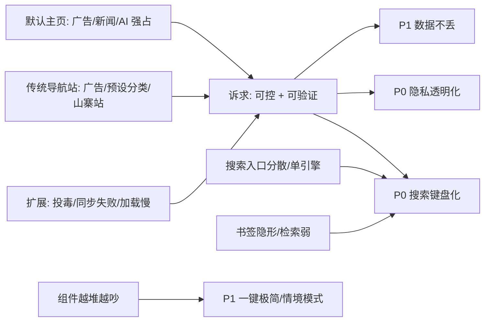

# edge-nav · 主页与搜索痛点调研及功能建议

> 调研日期：2026-11-06 ｜ 范围：浏览器默认新标签页、传统导航站、主流起始页扩展与自托管仪表盘
> 结论用途：为 edge-nav（Manifest V3 新标签页覆盖扩展，当前 `manifest.json` 版本 0.7.0）下一轮功能排期提供决策依据
> 说明：本报告**只做调研与建议，未改动任何源码**

---

## 0. 结论摘要

1. **市场的主要矛盾已经从「功能不够」变成「不敢信、太慢、太吵」。** 2025 年 12 月披露的 ShadyPanda 事件中，WeTab（约 300 万安装）与 Infinity V+（约 65 万安装）等新标签页扩展被曝长期收集浏览历史、搜索按键、Cookie 并具备远程代码执行后门，累计影响约 430 万 Chrome/Edge 用户；同期商店评论分析显示，Infinity 的负面反馈集中在同步失败、网络错误、图标丢失与空白页。用户对「主页」的第一诉求已是**可控与可验证**，而不是更多小组件。
2. **edge-nav 现有架构恰好命中了这一稀缺定位**：无 service worker、无后端、无账号、权限仅 4 项、外联域名白名单 5 个、图标走浏览器内置 `_favicon`、首屏 gzip 约 71 KB（预算 85 KB）、配置快照 + 导入导出 + 版本迁移。**不建议为了「对齐竞品」堆组件，那会主动放弃最大差异点。**
3. **真正值得补的是三块**：① 把「可信」做成产品内可见的能力（权限/外联清单 + 完全离线开关）；② 把搜索框与命令面板从「能用」做到「键盘优先」（自定义引擎、Tab 轮换、`!bang` 直搜、别名/拼音、最近使用）；③ 补上「数据不丢」的最后一环（轻量跨设备同步 + 配置体检）。
4. **明确不建议做**：任意页面全局搜索、内嵌 AI 问答、无差别 RSS 抓取、浏览器历史/标签页检索。这些能力需要 `<all_urls>`、`history`/`tabs` 或常驻后台，与最小权限和首屏体积预算直接冲突。

---

## 1. 调研方法与证据分级

| 级别 | 定义 | 本报告用途 |
|---|---|---|
| A | 安全厂商报告经主流媒体转述、官方文档/开源仓库 README、浏览器可验证行为 | 可作为决策依据 |
| B | 商店评论聚合分析、独立横评与实测数据、V2EX / 少数派等社区一手讨论 | 作为需求信号，数字标注来源 |
| C | 厂商软文、SEO 内容、二手观点文 | **只取定性描述，不采信其中的百分比数字** |

> 已知的样本偏差：中文检索结果中大量为扩展厂商投放的软文（WeTab / AItab / 各类「2026 推荐」文章），其「广告占比 40%」「70% 时间花在找入口」等数字无测量方法说明，本报告一律不作为事实引用，只用于归纳用户抱怨的**类别**。

---

## 2. 用户吐槽的痛点（按严重度归类）

### 2.1 默认主页：不受控的第一屏

| 痛点 | 具体表现 | 证据 | 级别 |
|---|---|---|---|
| 厂商内容强占首屏 | Edge 新标签页被 MS Start / Copilot、新闻、股票、天气占据；Firefox 掺入赞助链接与推荐文章；设置项分散在 NTP 齿轮、启动页、主页三处，关不干净 | UMA Technology 关闭新闻教程、`Just the Browser` 项目（用企业策略批量关掉 NTP 推荐内容） | A/B |
| 「最近访问」不等于「我想去」 | Chrome 默认展示算法选出的最常访问站点，删掉又会补新的；自定义快捷方式跨设备不同步；隐私上也不愿展示历史 | 少数派/个人门户分析文章、搜狐《简单几步，还你清爽干净的浏览器标签页》 | B/C |
| 越更新越重 | 浏览器升级后关掉的信息流可能重新出现；AI 入口被强行前置 | UMA Technology、`Just the Browser` | B |
| 极简派被忽视 | 一部分用户只想要 `about:blank`，任何元素都是噪音，但浏览器不提供「关闭 NTP 内容」的干净开关 | 搜狐文章、dev.to《Minimalist Browser Setup》 | B |

### 2.2 传统导航站：在别人的分类里找东西

| 痛点 | 具体表现 | 证据 | 级别 |
|---|---|---|---|
| 广告与弹窗 | 首页广告密度高、弹窗层层拦截，注意力被切碎 | TRAE 社区项目调研帖（定性）、TrueSight「认知噪音」 | C |
| 分类逻辑是运营方定的 | 用户想找的是自己那 8–12 个常访问站点，导航站却给出几十个预设分类 | 个人门户分析文章 | C |
| 官方站点辨识度低 | 搜索/导航结果里营销页、山寨站、钓鱼站混杂，需翻页试错 | TRAE 社区调研帖 | C |
| 多引擎交叉验证繁琐 | 需要开多个标签页、重复输入同一关键词再切换比对 | 同上；LikedTabs 多引擎指南 | B/C |

### 2.3 搜索：入口分散 + 单引擎绑定

| 痛点 | 具体表现 | 证据 | 级别 |
|---|---|---|---|
| 启动成本高于搜索本身 | 搜索被「困」在特定入口（NTP 搜索框 / 地址栏 / 搜索引擎页），每次都要先到达那里；Spotlight 式「按一个键就搜」被反复称道 | AItab 全局搜索稿（定性）、Launch X 自荐帖、Chrome 地址栏 `keyword + Tab` 用法 | B/C |
| 单引擎不够用 | 开发者要查 GitHub / Stack Overflow / MDN，学生要查 Scholar / arXiv，购物要比价；一个框绑一个引擎必须重复输入 | LikedTabs 多引擎指南、Chrome 多引擎切换指南 | B |
| 切换引擎靠鼠标 | 下拉菜单点选打断键盘流；青柠的「Tab 键切引擎」、数字键 0–9 直达被当作亮点反复提及 | 少数派 7 款启动页横评、3楼猫起始页推荐 | B |
| 自定义引擎缺失 | 小众垂直站点无法加入搜索框，只能先开书签再搜 | LikedTabs 指南 | B |
| 结果与隐私 | 搜索结果广告/仿冒站混杂；第三方起始页被曝记录搜索框按键并外传 | ShadyPanda 事件（Koi Security 报告转述） | A |

### 2.4 扩展本身：信任、可靠性与性能（**最高严重度**）

| 痛点 | 具体表现 | 证据 | 级别 |
|---|---|---|---|
| 知名扩展被「长期投毒」 | ShadyPanda 自 2018 年起先做正常壁纸/效率扩展积累口碑，再通过静默更新植入后门；收集浏览历史、搜索按键、鼠标坐标、Cookie、指纹，回传 17 个域名，每小时拉取任意 JS 执行。截至 2025-12-02，WeTab 与 Infinity V+ 仍可在 Edge 商店下载。Google 已下架受影响 Chrome 扩展 | Koi Security 报告（新浪财经、Admin By Request、郑州市网安协会转述）、V2EX 讨论串 | A |
| 同步 / 图标 / 空白页 | 商店评论聚合：Infinity（40 万活跃安装、4.6 分）抽样 35 条评论中负面 11 条，「功能与可靠性问题」被提及 14 次（网络错误、同步失败、图标丢失、无法添加快捷方式）；用户自发建议「定期备份配置」 | ExtWise 评论分析 | B |
| 首屏加载慢 | 独立实测：Tabliss ≈50 ms、NightTab ≈80 ms、Weather & Clock ≈90 ms，而 Momentum ≈400 ms、Infinity ≈500 ms；差距主要来自远程背景图与重型 JS | dev.to《I Compared 8 Firefox New Tab Extensions》 | B |
| 权限过大 + 强制登录 | 部分扩展申请 `history` / `tabs` / `<all_urls>`；Momentum 全功能需登录与付费；Infinity 申请 6 项权限（含 `background`、`unlimitedStorage`） | 同上、ExtWise、TrueSight 权限审计 | B |
| 功能臃肿反噬 | 「好看不中用、拖慢启动速度」「花里胡哨」是高频评价；极简与全能两派需求撕裂 | V2EX 讨论串、少数派横评 | B |
| 停止维护即数据丢失 | iChrome 停服导致用户配置无处可去；用户因此转向开源、可导出、可自托管 | dev.to 测评、自托管起始页指南 | B |

### 2.5 书签与入口管理

| 痛点 | 具体表现 | 证据 | 级别 |
|---|---|---|---|
| 书签「隐形」且层级深 | 书签栏只能放一行，文件夹三级以后懒得点；不打开收藏夹就看不见 | 个人门户分析、V2EX《大家在日常怎么管理浏览器书签》 | B/C |
| 检索能力弱 | 用户明确要求查重、拼音搜索、书签/历史/标签页统一检索；书签量一大前端搜索会卡 | V2EX /t/776167、/t/1076169 | B |
| 快捷键冲突 | 第三方全局搜索的 `Alt+Space` 常与 uTools / Spotlight 冲突，用户要求可自定义 | V2EX /t/1076169 | B |

---

## 3. 好用的主页/导航站，好在哪

| 产品 | 被认可的做法 | 可迁移到 edge-nav 的点 | 迁移成本 |
|---|---|---|---|
| **青柠起始页** | 近 10 个引擎 + 自定义引擎；**Tab 键切引擎**；**0–9 数字键直达前 10 站**；搜索框内翻译/计算器/快捷指令；除同步外无需登录 | Tab 轮换、`!bang` 前缀、数字键直达、自定义引擎 | 低 |
| **Tabliss / NightTab / Bonjourr** | 开源、纯本地存储、无账号、无遥测、可自定义 CSS、完整键盘快捷键、~50–80 ms 首屏 | 印证本项目路线正确；补「权限/外联透明页」把优势说出来 | 低 |
| **Momentum** | 每天只保留一个「今日焦点」，其余信息退居次要；视觉克制 | 「一键极简模式」/ 情境模式，避免卡片越堆越吵 | 中 |
| **Infinity / iTab / WeTab** | 图标与布局高度自定义、组件化信息密度、导入导出与云备份；iTab 支持点时间切到简约模式 | 正面：数据可携带；反面：同步可靠性与信任崩塌是最大流失点 | 中 |
| **Homer / Glance / Homepage** | 配置即代码（一份 YAML 可 Git 备份）、RSS / HN / 服务状态卡片、键盘导航、瞬时渲染 | 「配置可审计」理念；RSS 类功能受扩展权限限制，不宜照搬 | 高 |
| **start.me / Notion** | 多个页面对应不同情境（工作 / 客户 / 研究）、可共享 | 情境模式（工作 / 个人） | 中 |
| **Spotlight 式（AItab `Alt+X`、Launch X）** | 任意页面一键唤起，统一搜书签 / 历史 / 打开的标签页，工作流不中断 | 理念可借鉴；实现需全站注入，**不建议照搬** | 高（且违背权限最小化） |

**归纳出的 5 条共性**（也是产品设计的验收尺）：

1. **快**：首屏不依赖远程资源，冷启动感知在 100 ms 量级；
2. **可信**：无账号、开源或可审计、权限最小化、数据可导出；
3. **键盘优先**：一个键唤起、Tab/数字键切换、回车执行，鼠标是备选；
4. **信息密度可收可放**：既能一屏看全，也能一键只剩搜索框；
5. **不替用户做决定**：常用入口由用户显式添加与排序，不做算法推荐。

---

## 4. 结合 edge-nav：现状对照与硬约束

### 4.1 已经做对的（建议保持，不要动）

| 已有能力 | 对应解决的痛点 | 代码证据 |
|---|---|---|
| 纯本地、无账号、无后端；权限仅 `storage / unlimitedStorage / favicon / bookmarks` | 信任危机、权限滥用 | `public/manifest.json:11` |
| 外联仅 open-meteo ×2 + jsDelivr ×3；图标走内置 `_favicon`，失败回退首字母色块 | 隐私外传、图标服务泄露书签 | `public/manifest.json:12-18`、`src/utils/favicon.ts:8-20` |
| 首屏预算 70/12/85 KB（当前约 71 KB），设置抽屉与指引异步加载 | 竞品 400–500 ms 首屏 | `README.md:53-63`、`src/App.vue:16-18` |
| 配置快照（5 份）、导入/导出、迁移失败留 `config-raw` 原始备份 | 同步失败 / 数据丢失 | `src/store/config.ts:26-28`、`README.md:48-51,103-122` |
| Ctrl/Cmd+K 命令面板统一搜链接/书签/待办/笔记 | 入口分散、书签隐形 | `src/App.vue:37-54`、`src/components/CommandPalette.vue:148-231` |
| 书签导航是**只读镜像**，隐藏只写本地配置，从不删书签 | 用户不敢让扩展碰书签 | `README.md:87-101` |
| 深浅主题 + 两套视觉风格、工作日/节假日/调休日历 | 中文用户本地化差异 | `README.md:40-46,133-144` |

### 4.2 明确缺口

| 缺口 | 现状证据 |
|---|---|
| 产品内没有「权限与外联清单」，用户无法在扩展里验证「它不传数据」 | `SettingsPanel.vue:606-653` 只写了「数据存在本机」，未列权限与域名 |
| 搜索引擎硬编码 5 个，不能自定义；切引擎必须点鼠标 | `src/data/engines.ts:9-15`、`SearchBox.vue:46-69`；设置里也只是固定 chips（`SettingsPanel.vue:411-420`） |
| 搜索框键盘只处理 Esc，无 Tab 轮换、无 `!bang`、无搜索建议 | `SearchBox.vue:33-38` |
| 命令面板仅 `includes` 子串匹配、结果截前 40 条，无拼音/别名、无最近使用排序、不能把关键词送搜索引擎 | `CommandPalette.vue:233-242`、`68-144` |
| 没有「常用站点」，也没有跨设备同步（`chrome.storage.local` 单设备） | `src/types.ts:117-151`、`README.md:109` |
| 没有配置体检（重复链接、空标题、图标缺失） | `SettingsPanel.vue:190-320` 的数据操作仅导入/导出/恢复 |
| README 第 11 节列了 4 项待办（右键加当前页、书签拖拽写回、笔记 Markdown 预览/跨卡片搜索、上架商店），尚未实现 | `README.md:184-189` |

### 4.3 架构硬约束（所有建议必须在此边界内评估）

1. **无 service worker、无后端**：任何需要后台常驻、右键菜单、`omnibox`、全站注入的能力都要先改架构。
2. **权限与白名单固定**：`host_permissions` 只有 5 个域名，**不能**对任意网址发 `fetch`/HEAD 探测；但 `openUrl()` 用 `window.open` / `location.href` 跳转外部 URL **不需要** host 权限（`src/utils/openUrl.ts:5-10`）——因此「自定义搜索引擎」是零权限成本功能。
3. **首屏体积预算 85 KB gzip，当前约 71 KB**：`SearchBox.vue`、`CommandPalette.vue` 属于首屏 chunk，新增逻辑必须控制在几 KB；设置面板是异步 chunk，适合放复杂 UI。
4. **改默认值必须写迁移**：`CONFIG_VERSION = 8`（`src/store/config.ts:28`），任何新增配置字段都要 v8→v9 迁移，否则老用户读不到。
5. **落盘是 deep watch + 200 ms 防抖**：高频写入（点击计数、秒级计时）不能塞进 `config`，应单独存键或放组件本地状态。
6. **没有 `history` / `tabs` / `sessions` 权限**：浏览器历史、已开标签页检索默认不可做。

### 4.4 核对中发现的文档不一致（建议顺手修）

| 位置 | 问题 |
|---|---|
| `README.md:175` | 写「当前 `CONFIG_VERSION = 6`」，实际 `src/store/config.ts:28` 为 **8**（v7 增加 `search.openInNewTab`/`todos[].url`/`focus`，v8 增加 `layout` 两个开关） |
| `README.md:69` 与 `CODEBUDDY.md` 架构总览 | 缩放上限口径不一致：README 写 `min(…, 1.6)`，CODEBUDDY.md 写 `min(容器宽/1120, 1.05)`；属版本演进遗留，需以 `src/data/layout.ts` / `CanvasBoard.vue` 当前实现为准统一 |
| `README.md:196` | 发版示例仍写 `0.6.0`，而 `manifest.json:5` 为 `0.7.0`（示例性质，非功能问题） |

---

## 5. 功能建议（P0 → P1 → P2）

> 优先级判据：**用户痛点严重度 × 实现成本 × 是否强化「可信 + 快 + 键盘优先」定位**。凡是需要扩权或常驻后台的，一律降级。

### P0 · 建议下一版本就做（3 项，均可不改 manifest 权限）

#### P0-1 「隐私与权限」透明页 + 完全离线开关

- **解决**：2.4 的信任危机；把项目最大优势从 README 搬进产品。
- **落点**：`SettingsPanel.vue:606-653`「数据与分享」区扩展（异步 chunk，不占首屏预算）；`config` 新增 `network.allowOnlineData`（走 v8→v9 迁移），`useWeather.ts` / `holidaySync.ts` 读该开关；`manifest.json:12-18` 的白名单以静态清单展示。
- **内容**：4 项权限逐条说明用途、5 个外联域名及用途、本地存储键清单（`edge-nav:config` / `:snapshots` / `:weather-cache` / `:holidays` / `:config-raw`）、「一键完全离线」（禁用天气与节假日在线拉取，用缓存/内置表）、导出按钮。
- **验收**：开启离线后用 CDP/DevTools Network 面板确认 0 个外部请求；`npm run check:budget` 不增长（设置是异步 chunk）。
- **风险**：低。切忌把「不收集数据」写成绝对承诺——天气请求本身会带经纬度，说明里要写清。

#### P0-2 搜索引擎可编程：自定义引擎 + Tab 轮换 + `!bang` 直搜

- **解决**：2.3「单引擎绑定 / 切换靠鼠标 / 垂直站点搜不到」；青柠、LikedTabs、Chrome `keyword+Tab` 共同验证的高频好评点。
- **落点**：`src/data/engines.ts` 保留 5 个内置引擎作为默认值，新增 `config.search.engines`（`{id, name, url, shortcut, enabled}`）与 v9 迁移；`SearchBox.vue:16-38` 在 `submit()` 前解析 `!gh vue router` 之类前缀，输入框有内容时 `Tab` 轮换到下一引擎；`SettingsPanel.vue:409-433` 增加引擎增删改与排序。
- **关键实现约束**：
  1. bang 解析必须在 `normalizeUrl()`（`src/utils/favicon.ts:23-31`）**之前**，否则 `!` 不会被当网址、但顺序错误会把 `github.com/foo` 误判；
  2. `Tab` 只在输入框聚焦且有内容时拦截，否则会吞掉页面正常的焦点切换；
  3. 命令面板的 window 级 `keydown` 必须先判 `paletteOpen`（`CommandPalette.vue:262-264`），避免两层抢键；
  4. URL 模板用 `encodeURIComponent` 拼接，沿用现有 `openUrl()`，无需新增 `host_permissions`；
  5. 默认引擎与引擎列表进入导入导出（`utils/configTransfer.ts` 的合并分支只补链接，不覆盖用户的引擎配置）。
- **验收**：`typecheck` + `check:budget`（增量应 < 1 KB gzip）+ `scripts/feature-check.mjs` 增补 bang/Tab 用例；v8 老配置加载后引擎列表不为空。
- **风险**：低。主要坑是中文输入法 `isComposing` 与 Tab 的组合，需沿用 `App.vue:38-39` 的判定。

#### P0-3 命令面板匹配质量：别名/拼音 + 最近使用 + 关键词直送引擎

- **解决**：2.5「拼音搜索、书签检索弱」+ 2.3「搜索入口分散」；V2EX 用户明确提过拼音搜索与大数据量卡顿。
- **落点**：`CommandPalette.vue:233-242`（匹配与排序）、`:128-143`（动作列表新增「在 X 中搜索：关键词」）、`:148-231`（内容条目去重逻辑）。
- **实现要点**：
  1. **不引入 `pinyin-pro` 等词典库进首屏**（会击穿 85 KB 预算）。推荐方案：给 `LinkItem` / `TodoItem` 增加可选 `alias` 字段，在**设置面板异步 chunk** 里由用户录入或从标题生成拼音索引并持久化到 config；首屏只读索引做匹配。
  2. 排序改为「精确前缀 > 包含 > 别名/拼音 > 最近使用」，最近使用计数用**独立 storage 键**（如 `edge-nav:usage`）限长 Top 50，避免每次回车触发 `config` deep watch 落盘。
  3. 结果上限 40 条保留（防止大书签库卡顿），但空查询时改为「最近使用 6 条」而非固定前 6 条链接。
  4. 「在 X 中搜索」动作复用 P0-2 的引擎列表，实现「Ctrl K → 输入 → 回车直接搜」的 Spotlight 体验，**无需全站注入**。
- **验收**：1000 条链接下输入响应 < 50 ms（可在 `utils/perf.ts` 的 `markReady` 旁加埋点）；回归 `Esc` 逐层关闭与方向键不被吞（见 `CODEBUDDY.md` 坑点）。

### P1 · 值得排期，但先做技术验证

| # | 功能 | 解决痛点 | 落点 / 实现要点 | 成本与风险 |
|---|---|---|---|---|
| 4 | **一键极简 / 情境模式**（工作、个人、下班） | 组件越堆越吵；极简派 vs 全能派撕裂 | `config` 增 `modes`（含每模式的可见卡片与分组），`CanvasBoard.vue` 渲染前过滤；**先做最小版**：一个开关隐藏除 overview + links 外全部卡片，Esc 退出 | 中。若每种模式要独立卡片坐标，复杂度陡增，建议 v1 只过滤可见性、共用一套坐标 |
| 5 | **本地「常用站点」Top 8** | Chrome「最近访问」被吐槽是算法推荐；导航站层级深 | 只在扩展内记录用户**显式点击**的磁贴/面板链接，存独立键、90 天衰减、可一键清空；在 `LinkGrid.vue` 顶部加一排 | 低-中。必须避开 config deep watch；且要显式标注「由你的点击生成，不读取浏览历史」 |
| 6 | **配置体检**：重复 URL / 空标题 / 缺协议 / 图标回退计数 | V2EX 用户要「查重」；Infinity 差评里图标丢失是重灾区 | `SettingsPanel.vue` 加「体检」按钮（异步 chunk），纯本地静态扫描 `config.groups` + `bookmarks.extras`，输出可勾选修复清单 | 低。**硬限制**：`host_permissions` 不允许对任意域名发 HEAD，做不了真实死链探测；若要探测需申请 `<all_urls>`，不建议 |
| 7 | **轻量跨设备同步**（`chrome.storage.sync`） | Infinity 差评最集中的「同步失败」；README 明确写了「换机靠导出文件」 | 只同步除 `wallpaper.image`（可达 1.5 MB）外的文本配置；配额约 100 KB 总量 / 单项约 8 KB（**需按当前 Edge 版本实测**）；用 `version + updatedAt` 做 last-write-wins，保留本地快照，提供「以本机为准 / 以云端为准」 | 中-高。多设备并发覆盖可能丢布局；上线前必须做冲突 spike，并确认 `storage` 权限已覆盖 sync |
| 8 | **右键「把当前页加入导航」**（README 第 11 节已有） | 添加网址路径长 | 需 `background.service_worker` + `contextMenus` 权限，写入 `config.bookmarks.extras` | 中。**打破「无 service worker」架构**，且新增权限需重新向用户解释；建议与 P0-1 的透明页同一版本上线 |

### P2 / 明确不做清单（避免走回竞品老路）

| 提议 | 结论 | 依据 |
|---|---|---|
| 任意页面全局搜索（`Alt+X` / `Alt+Space`） | **不做** | 需 content script + `<all_urls>` 或常驻后台，且快捷键易与 uTools/Spotlight 冲突；用 P0-3 的「Ctrl K → 回车直搜」在 NTP 内覆盖 80% 价值 |
| 内嵌 AI 问答 / 摘要组件 | **不做**，降级为自定义引擎 | 需 API Key 与新增外联域名；ShadyPanda 之后用户对「AI 起始页」警惕。P0-2 里加一条 `https://…/?q=%s` 模板即可零成本覆盖 |
| RSS / 服务状态卡片 | **暂缓** | 用户自定义源需要扩大 `host_permissions`；若做，先做固定白名单 + 默认关闭的原型，并单独评估体积 |
| 浏览器历史 / 已开标签页检索 | **默认不做** | 需 `history` / `tabs` 权限，与「最小权限 + 无遥测」定位冲突；若将来做，必须显式可选、默认关闭、且写进权限透明页 |
| 移动端 / 跨端一致 | **结构性不可达** | Chrome/Edge 移动版不支持扩展；现有 < 720 px 流式降级（`README.md:156`）只覆盖桌面窄窗口，不应承诺移动端体验 |

---

## 6. 建议实施顺序与验收门禁

1. **一批 P0**（P0-1/2/3 可合并为一个版本，共同需要 v8→v9 迁移）→ 顺手修 4.4 的文档不一致。
2. **门禁**：`npm run typecheck` → `npm run build` → `npm run check:budget`（首屏 ≤85 KB，新增功能后应仍 ≤75 KB）→ `npm run check:version` → CDP 回归（`scripts/feature-check.mjs` 等，注意脚本里需先关掉首次引导遮罩并设 `Emulation.setDeviceMetricsOverride`，否则 800 px 会进流式模式禁用拖拽）。
3. **迁移回归**：构造 v8 配置样本，验证 `migrate()` 不抛错、不静默覆盖、失败时写 `edge-nav:config-raw`。
4. **P1 前置 spike**：`chrome.storage.sync` 配额与冲突行为实测（#7）、拼音索引生成对首屏体积的影响（P0-3）。
5. **P1 顺序建议**：#5 → #6 → #4 → #8 → #7（按「不扩权、不常驻」优先）。

---

## 7. 显式遗留项 / 未验证事项

- 本报告基于公开评论、横评与安全报道，**未做定量用户调研**；中文结果存在厂商软文偏差，痛点排序是定性判断。
- 竞品性能数字（50–500 ms）引自第三方实测，**未在本机复现**；edge-nav 自身首屏数字取自 README 的预算脚本，未重新跑 `npm run build && npm run check:budget`。
- `chrome.storage.sync` 的配额、单项上限与多设备冲突行为未实测；拼音索引方案未做体积验证。
- 未验证 `_favicon` 接口对用户自定义引擎域名/本地地址的回退表现。
- 未评估上架 Edge / Chrome 商店后，新增权限（`contextMenus`、service worker）对审核与用户信任的影响。
- 本报告**未改动任何源码或配置**；`README.md:175` 等文档不一致仅登记，未修复。

---

## 8. 参考来源

**A 级**
1. 新浪财经／快科技转述 Koi Security《ShadyPanda》报告（2025-12-02）— https://finance.sina.cn/tech/2025-12-02/detail-infzmaxc2619597.d.html
2. Admin By Request, *ShadyPanda Weaponizes Trusted Browser Extensions in 7-Year Campaign* — https://www.adminbyrequest.com/en/blogs/shadypanda-weaponizes-trusted-browser-extensions-in-7-year-campaign
3. 郑州市网络安全协会，长达 7 年的 ShadyPanda 攻击说明 — https://www.zzwa.org.cn/10172
4. Just the Browser 项目（用企业策略关闭 NTP 推荐内容 / AI / 遥测）— https://prohoster.info/en?p=153513 、https://mundobytes.com/en/script-just-the-browser-cleans-your-browser-of-AI-telemetry-and-embedded-advertising/
5. nightTab README（本地存储、键盘快捷键、自定义引擎）— https://github.com/zombieFox/nightTab

**B 级**
6. ExtWise, *Infinity New Tab: Permissions, Reviews & Competitor Analysis*（40 万安装、评论情感与可靠性问题）— https://extwise.com/extension/infinity-new-tab
7. dev.to, *I Compared 8 Firefox New Tab Extensions*（首屏耗时、权限与隐私对比）— https://dev.to/weatherclockdash/i-compared-8-firefox-new-tab-extensions-so-you-dont-have-to-44b6
8. V2EX《笑不出来，用了好多年的 Infinity 新标签页 疑似被投毒》— https://www.v2ex.com/t/1176399
9. V2EX《大家在日常怎么管理浏览器书签》/《Chrome 怎么更便捷的打开书签？》/ Launch X 自荐帖 — https://www.v2ex.com/t/776167 、https://www.v2ex.com/t/977119 、https://v2ex.com/t/1076169
10. 少数派《找到适合自己的「浏览器门面」，7 款启动页插件横评》（青柠 / iTab / Momentum 特性）— https://sspai.com/ （检索到的转载：https://www.unsafe.sh/go-125604.html）
11. Position Is Everything / dev.to，Tabliss、Bonjourr、Momentum、start.me 特性与取舍 — https://www.positioniseverything.net/10-best-browser-start-pages-to-customize-your-workspace/
12. LikedTabs, *Search widget guide 2026*（多引擎分类、键盘选引擎、自定义 URL 模板）— https://likedtabs.com/es-cl/blog/search-widget-custom-engines-guide-2026
13. 自托管仪表盘对比（Homer / Glance / Homepage 的配置即代码与信息密度）— https://www.cloudspress.com/5-self-hosted-dashboards-that-can-replace-your-browsers-new-tab-page 、https://homelabcompass.com/alternatives/self-hosted-dashboard

**C 级（仅作定性参考）**
14. 从导航站到个人门户：我们到底需要怎样的「上网入口」— https://www.800188.com/zh/technical-articles/5666-cong-dao-hang-zhan-dao-ge-ren-men-hu-wo-men-dao-di-xu-yao-zen-yang-de-shang-wang-ru-kou.html
15. 搜狐《简单几步，还你清爽干净的浏览器标签页》— https://m.sohu.com/a/573699023_120737018
16. AItab 全局搜索功能稿、WeTab 功能稿、TRAE 社区导航赛道调研帖（其中的百分比数字未采信）
