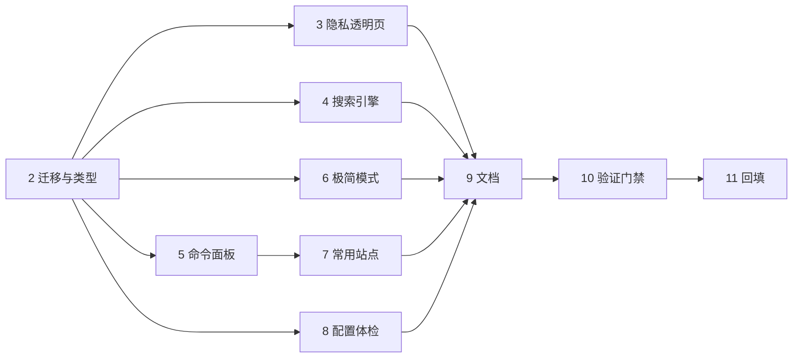

# edge-nav 开发改造任务清单（对应《主页与搜索痛点调研及功能建议》）

> 建立日期：2026-11-06 ｜ 执行模式：Agent ｜ 状态以本文件为准
> 范围说明：执行报告中 **P0 全部 + P1 中不扩权、不需常驻后台的 4 项 + 文档一致性修复**；
> 跨设备同步、右键菜单、全局搜索 / AI / RSS / 历史检索列入「本次不纳入」，理由见文末。
> **完成日期：2026-11-06 ｜ 状态：11/11 完成，全部静态门禁绿灯（未提交 git commit）**

## 任务表

| # | 任务 | 主要文件 | 状态 | 验收 | 结果 |
|---|---|---|---|---|---|
| 1 | 建立本清单与进度跟踪 | `docs/开发改造任务清单.md` | ✅ | 清单可读、状态可更新 | 已回填 |
| 2 | 配置 v8→v9 迁移与类型扩展（engines / network / view / usage / alias） | `src/types.ts`、`src/store/config.ts`、`src/utils/configTransfer.ts` | ✅ | 老配置加载不丢数据；`CONFIG_VERSION=9`；失败仍走 `config-raw` 备份 | `npm run check:migrate` 3 用例通过 |
| 3 | P0-1 隐私与权限透明页 + 完全离线开关 | `SettingsPanel.vue`、`data/privacy.ts`、`useWeather.ts`、`holidaySync.ts`、`App.vue` | ✅ | 产品内可见 4 项权限 / 5 个外联域名 / 存储键；离线开关后无外部请求 | 设置里已列出；两处在线请求均受开关控制 |
| 4 | P0-2 搜索引擎可编程：自定义引擎 + Tab 轮换 + `!bang` + 设置管理 | `data/engines.ts`、`SearchBox.vue`、`SettingsPanel.vue`、`CommandPalette.vue` | ✅ | 自定义 URL 模板可用；Tab 只在输入框有内容时轮换；bang 解析早于网址识别；不新增 host 权限 | 已实现；`manifest.json` 未改动 |
| 5 | P0-3 命令面板：别名/拼音索引 + 最近使用排序 + 关键词送引擎 | `store/usage.ts`、`utils/pinyin.ts`、`CommandPalette.vue` | ✅ | 拼音首字母可搜中文链接；点击计数不进 config；空查询显示最近使用；`Esc`/方向键回归 | 打分匹配 + 独立存储键；拼音表只在设置 chunk |
| 6 | P1-4 一键极简 / 情境模式 | `CanvasBoard.vue`、`SettingsPanel.vue`、`App.vue`、`CommandPalette.vue` | ✅ | 只留概览与导航卡；stage 高度按可见卡片算；编辑态自动退出；Esc 可退出 | `visibleWidgets` 视图层过滤，隐藏卡片不参与碰撞/夹紧 |
| 7 | P1-5 本地常用站点 Top 8（不申请 `history`） | `LinkGrid.vue`、`store/usage.ts`、`SettingsPanel.vue` | ✅ | 「常用」虚拟标签按显式点击生成，可关闭/清空；不读取浏览历史 | 虚拟标签命名「常去」以避开默认分组重名；`pagehide` 强制 flush |
| 8 | P1-6 配置体检（重复 / 空标题 / 协议 / 别名缺失） | `utils/configAudit.ts`、`utils/pinyin.ts`、`SettingsPanel.vue` | ✅ | 纯本地静态检查、可一键去重与批量补别名；不对任意域名发请求 | 已实现，设置抽屉内异步 chunk |
| 9 | 文档一致性修复 | `README.md`、`CODEBUDDY.md` | ✅ | `CONFIG_VERSION`、缩放上限、发版示例与源码一致；新功能写入功能表 | 9 / 1.05 / 0.7.0 已对齐；坑点清单 15→19 条（13:41 补至 20 条） |
| 10 | 验证门禁 | 命令行 | ✅ | `typecheck` / `build` / `check:budget` / `check:version` 全绿；CDP 回归尽可能执行 | 见下方「验证结果」；CDP 未执行 |
| 11 | 回填清单状态与工作区记忆 | 本文件、`.workbuddy/memory/2026-11-06.md` | ✅ | 状态全 ✅，遗留项显式登记 | 已回填 |

## 实施顺序与依赖

## 硬约束（每项改造都不得突破）

1. `manifest.json` 权限与 `host_permissions` **保持原样**（4 项权限 / 5 个域名），不引入 service worker、`<all_urls>`、`history`、`tabs`。✅ 已核对，`public/manifest.json` 零改动。
2. 首屏 gzip ≤ 85 KB（改造前约 71 KB）；复杂 UI 只放设置抽屉（异步 chunk）。✅ 实测 74.7 KB。
3. 任何新配置字段必须走 `migrate()`；改 `DEFAULT_CONFIG` 不影响老用户。✅ `check:migrate` 覆盖。
4. 高频写入（点击计数）不进 `config`，用独立存储键 + 防抖。✅ `edge-nav:usage` 独立键；原地跳转 / 关页前 `flushUsage()`。
5. 命令面板的 window 级 `keydown` 必须先判 `paletteOpen`；输入法 `isComposing` 时快捷键不生效。✅ 未改动这两处。
6. 拖拽/网格相关既有坑点不回归（`README.md` 第 10 节 20 条 + `CODEBUDDY.md` v0.6/v0.7/v9 补充）。⚠️ 仅静态核对，未做 CDP 拖拽回归。

## 验证结果（2026-11-06 实测）

| 门禁 | 命令 | 结果 |
|---|---|---|
| 类型 | `npm run typecheck` | ✅ 无输出（通过） |
| 构建 | `npm run build` | ✅ 93 modules，最终 7.97s |
| 首屏体积 | `npm run check:budget` | ✅ JS 65.0 / 70 KB，CSS 9.7 / 12 KB，合计 **74.7 / 85 KB**；设置抽屉 chunk 13.64 KB gzip 不计首屏 |
| 版本 | `npm run check:version` | ✅ 0.7.0 一致 |
| 配置迁移 | `npm run check:migrate`（新增） | ✅ 3 用例：v8 老配置业务数据全保留 / 引擎脏数据自修复且当前引擎回落 / 异常配置写 `config-raw` 备份 |

**环境备注（构建 OOM）**：11:41 前后系统空闲物理内存一度只剩 1.3 GB（同机多个其它项目的 dev server 常驻），连续几次 `npm run build` 在 `transforming` 阶段报 `Fatal process out of memory: Zone` / `memory allocation of 19208 bytes failed`，退出码 3/127/134。这是 Node/V8 的原生 Zone 分配失败，**与本次代码无关**：同一份源码在改造过程中已成功构建过。内存恢复后标准 `npm run build` 重新成功，产物与 74.7 KB 预算一致。应急办法是 `NODE_OPTIONS="--max-old-space-size=512 --max-semi-space-size=1" vite build --minify false` 先出未压缩产物，但其首屏 gzip 约 100 KB，**不能作为交付产物**；最终 dist 已用标准构建覆盖。

**CDP 回归未执行**：`scripts/*.mjs` 的浏览器回归脚本需要 `localhost:5274` 预览页与 9222 调试端口，本机当前没有运行中的调试浏览器。以下项目前只有静态验证与源码审查，没有 UI 级实测：拖拽/吸附、极简模式切换视觉、常去标签点击、自定义引擎实际跳转、完全离线模式下的网络请求。建议在加载到 Edge 扩展后手工过一遍。

**未提交**：所有改动仍在工作区，`git commit` 由用户自行决定。

## 本次不纳入（显式遗留）

| 项 | 原因 |
|---|---|
| `chrome.storage.sync` 跨设备同步（报告 #7） | 需实测配额与多设备冲突策略；壁纸 base64 可达 1.5 MB，必须剥离；盲目上线有覆盖用户布局的风险 |
| 右键「把当前页加入导航」（报告 #8） | 需要 `background.service_worker` + `contextMenus`，打破「无后台」架构并新增权限，应先单独评审 |
| 任意页面全局搜索、内嵌 AI、RSS、历史/标签页检索（报告 P2） | 需 `<all_urls>` / `history` / `tabs` 或扩大外联白名单，与最小权限定位冲突，报告已判定「不做」 |
| 移动端 | Chrome/Edge 移动版不支持扩展，结构性不可达 |
| CDP / 真机 UI 回归 | 环境无调试浏览器；未做定量用户调研，竞品性能数字未在本机复现 |
| 拼音表覆盖率 | 只覆盖常用简体字首字母，多音字取最常见读音；不认识的字跳过，用户可手动填 `links[].alias` |
| 自定义引擎域名的 `_favicon` 回退 | 未实测；图标失败已有首字兜底 |

## 打包交付（2026-11-06 11:51）

> 注：本节记录的首次产物已被 13:41 的重新打包覆盖，**以文末「离线缺口修复与重新打包」为准**。

新增 `scripts/pack.mjs` + `npm run pack`（纯 Node `zlib` 手写 ZIP，本机没有系统 `zip` 命令，也不引第三方包），输出结构与 `release.yml` 完全一致：进入 `dist/` 后打包内容，压缩包根目录直接是 `manifest.json`，文件名 `edge-nav-v0.7.0.zip`。打包前做与 CI 相同的清单校验：MV3、`chrome_url_overrides.newtab` 指向的文件存在、4 个图标齐全、`dist/manifest.json` 与 `package.json` 版本一致；并过滤 `.map` / `.DS_Store` / `Thumbs.db` / `_probe*`。

| 校验 | 结果 |
|---|---|
| 打包前门禁 | ✅ `typecheck` / `check:version` / `check:migrate` / `build`（93 modules，8.11s）/ `check:budget`（74.7 / 85 KB） |
| 产物 | ✅ `edge-nav-v0.7.0.zip`，15 条目（13 文件 + 2 目录），原始 274.5 KB → 101.1 KB |
| 独立解压验证 | ✅ 用系统 `Expand-Archive` 解压，根目录为 `assets/ icons/ index.html manifest.json theme-init.js`；13 个文件 SHA256 与 `dist/` 逐一对齐，0 缺失 / 0 内容不一致 / 0 多余；`manifest_version=3`、`version=0.7.0`、`newtab=index.html`、权限仍为 `storage, unlimitedStorage, favicon, bookmarks` |
| `public/manifest.json` | ✅ 本轮零改动 |

**遗留**：验证时创建的临时解压目录在删除环节触发宿主安全策略 `SAFE_DELETE_FAIL_CLOSED` 报错，复查项目内 `.preview/pack-check` 已不存在（`.preview/` 本身被 `.gitignore` 忽略），`%TEMP%\edgenav-check-*` 可能仍有一份残留，可手动删除；均不影响产物与 git 状态。打包产物 `*.zip` 被 `.gitignore` 忽略，未提交。

## 离线缺口修复与重新打包（2026-11-06 13:41）

**🟡 已修复**：源码核对发现「完全离线」开关漏了设置里的手动「搜索城市」——`SettingsPanel.vue:152-160` 直接 `fetch('https://geocoding-api.open-meteo.com/...')`，无 `allowOnlineData` 判断，且输入框回车可绕过按钮禁用；与 `SettingsPanel.vue:767`「关掉即不再请求下面 5 个域名」的承诺不符。

修复内容：

1. `searchCity()` **函数入口**加离线 guard 并置 `cityStatus = 'offline'`（回车也拦得住）；
2. 查询按钮 `:disabled` 增加 `!config.network.allowOnlineData`，天气城市区与状态链各加一条离线提示；
3. `data/privacy.ts` 中 geocoding 的说明补上「完全离线模式下该入口被禁用」；
4. `README.md` 坑点清单 19 → 20 条、`CODEBUDDY.md` v9 补充段同步登记。

复核：`grep -rn "fetch(" src/` 全项目仅 3 处 —— 本次修复的 `SettingsPanel.vue:166`、`useWeather.ts:94`（受 `useWeather.ts:65` 拦截）、`holidaySync.ts:97`（受 `ensureHolidayData` 的 `allowNetwork` 参数拦截），已无遗漏。

| 校验 | 结果 |
|---|---|
| 门禁 | ✅ `typecheck` / `check:version`（0.7.0）/ `check:migrate`（3 用例）/ `build`（3.31s）/ `check:budget`（74.7 / 85 KB，设置抽屉 chunk 13.78 KB gzip 不计首屏） |
| 新产物 | ✅ `edge-nav-v0.7.0.zip` 101.2 KB，15 条目（13 文件 + 2 目录），原始 275.0 KB |
| 独立校验 | ✅ 系统 `unzip -t` CRC 全部 OK；`unzip -p <entry> \| cmp - dist/<entry>` 逐字节比对 13 个文件，**0 不一致**；根目录直接是 `manifest.json` |
| 权限 | ✅ `public/manifest.json` 仍为零改动 |

**本次未纳入**：🟢 `App.vue:81` 只在挂载时调 `ensureHolidayData`，从「离线」切回「在线」不会立即重新拉取节假日（需刷新页面或手动点「更新节假日」）；按本轮约定的范围只修 🟡，保留登记。CDP / 真机 UI 回归仍未跑；全部改动未提交。

## 网址导航「保证两行」改造（2026-11-06 14:02）

**诉求**：截图反馈网址导航要滚动、第二行看不清，要求「保证两行的高度」。

**根因（可量化）**：`links` 卡默认 `h=220`（`src/store/config.ts:849`），扣掉 `--card-pad` 上下 32px 与 `CardHead` 24px + 10px 后网格约 147–150px；旧磁贴 = 42px 图标 + 6px 间距 + 16px 标题 + 15px padding ≈ 79px，两行 `79×2+8=166px` 超出，必然竖滚并裁掉第二行。同时 `minmax(104px, 1fr)` 列宽偏窄，中文站名大量被省略号截断。

**方案**：不动 `DEFAULT_CONFIG` / 坐标 / 版本号，纯 `LinkGrid.vue` 内改造。

| 改动 | 落点 |
|---|---|
| 磁贴压到 65px（图标统一 `min(--tile-icon-size, 34px)`、gap 4、padding 5/4） | `LinkGrid.vue` `.link__anchor` / `.link__icon` |
| 列宽 104 → 128px（窄屏 72 → 88px），标题截断大幅减少 | `LinkGrid.vue` `.links__grid` |
| 网格 `flex: 1 1 auto` 撑满卡片，容量计算才有稳定 `clientHeight`（也顺带让内容少时真正垂直居中） | `LinkGrid.vue` `.links__grid` |
| 新增 `measureGrid()`：`ResizeObserver` 重算列数（读计算后的 `gridTemplateColumns`）与可容纳行数 `floor((clientHeight+8)/(磁贴实测高+8))`，上限 2 行；`pagedRows` 按 `cols × rowsFit` 切片，超出翻页 | `LinkGrid.vue` 脚本 |
| 翻页胶囊放进 `CardHead`（不占网格高度，否则吃掉 24px 会让两行变一行）；浏览态 `overflow: hidden` | `LinkGrid.vue` 模板 / `.links__grid--paged` / `.links__pager` |
| 编辑态不分页、退回全量滚动，拖拽索引用 `offset + index`；切标签回到第 1 页，容量变化时 clamp 页码 | `LinkGrid.vue` 脚本 |
| `fits` 兜底：`clientHeight < 磁贴实测高 + 2` 时自动退回滚动模式，宁可出滚动条也不硬裁 | `LinkGrid.vue` `paged` / `measureGrid()` |

**零成本**：无配置字段、无 v9→v10 迁移、无权限变化、`public/manifest.json` 仍为零改动。

### 真机 UI 实测（本轮首次跑通 CDP）

用 `npm run preview`（5274）+ 无头 Chrome（`--headless=new --remote-debugging-port=9222`）+ 现有 `scripts/cdp-eval.mjs` 求值，向 `localStorage['edge-nav:config']` 注入测试链接后 reload，测量 `getBoundingClientRect()` 真实几何。验证脚本留在 `.preview/measure-links.js`、`.preview/seed-*.js`、`.preview/verify-*.js`（该目录被 `.gitignore` 忽略）。

| 场景 | 实测结果 |
|---|---|
| 默认 6 条 | 网格 `clientHeight=147 / scrollHeight=147`，`overflow:hidden`，1 行，0 裁切 |
| **18 条中文长标题**（1422×804，卡片 1254×220） | **9 列 × 2 行 = 18 格一页显示**，`scrollHeight=clientHeight=147`，`clippedTiles=0`，`titlesCut=0`（连「哔哩哔哩弹幕网」「高德地图开放平台」都不截断） |
| 24 条超出容量 | 第 1 页 18 条 / 2 行、页脚 `‹ 1 / 2 ›`；点下一页 → 第 2 页 6 条 / 1 行、`‹ 2 / 2 ›`；两页均 `clippedTiles=0`、`scrollHeight=147` |
| 编辑态切换 | 24 条全量 + 1 个「添加」磁贴，`overflow:auto`、`paged=false`、全部 `draggable=true`；切回浏览态分页恢复 |
| 700px 窄屏流式 | 6 列 × 2 行 = 12 格，`clippedTiles=0`、`titlesCut=0`、页脚 `‹ 1 / 2 ›` |
| 运行时把卡片压到 120px | `clientHeight=47 < 65`，`paged=false`、`overflow:auto`、`--more` 渐隐生效、18 条全量可滚（**不硬裁**） |
| 补 `fits` 兜底后回归 | 18 条仍为 9 列 × 2 行、`scrollHeight=clientHeight=147`、`clippedTiles=0`、`titlesCut=0` |

> 说明：此前各节记录的「CDP 回归未跑」指**当时**状态；本轮针对网址导航已补上 UI 级实测。其余（拖拽吸附、极简模式视觉、自定义引擎实际跳转、完全离线无请求）仍未跑。`src/store/config.ts:326-335` 已有 `links.h < 220 → 220` 的迁移规则，所以矮卡片只能在运行时（用户当次拖拽）出现，配置层模拟不了，验证时直接改 `.frame` 的 DOM 高度。

### 门禁与产物

| 校验 | 结果 |
|---|---|
| `typecheck` / `check:version` / `check:migrate` | ✅ 通过（0.7.0、3 用例） |
| `build` | ✅ 93 modules / 3.52s |
| `check:budget` | ✅ JS 65.6 + CSS 9.9 = **75.5 / 85 KB**（较 74.7 KB +0.8） |
| `npm run pack` | ✅ `edge-nav-v0.7.0.zip`，102.0 KB / 15 条目 |
| 独立校验 | ✅ `unzip -t` CRC 全 OK；13 个文件 `unzip -p \| cmp - dist/` 逐字节比对 **0 不一致** |

**遗留项**：① `ROW_LIMIT = 2` 是刻意的密度上限，卡片被拖高时仍只显示两行（拖矮会自动降到 1 行；矮到连一个磁贴都放不下时退回滚动，始终不硬裁）；若想「拉高卡片自动多显示几行」，把该常量调大即可。② 编辑态切回浏览态保留当前页码（不强制回第 1 页）。③ 拖拽排序跨页索引只在编辑态生效（`offset=0`），已静态核对、未做拖拽动作实测。④ 验证用的 `.preview/chrome-profile` 为无头浏览器临时 profile，被 `.gitignore` 忽略，可手动删除。⑤ **全部改动仍未提交**。

---

## 缺陷修复：搜索引擎下拉「点击没反应」（2026-11-06 14:18）

**现象**：用户截图反馈搜索框左侧引擎按钮点击无任何反应。

**根因（CDP 实测，非推测）**：下拉其实已渲染（`opacity=1`、`visibility=visible`、191×160px、在视口内），但 `top=223` 恰好等于 `.ov` 的底边 `219`。`.ov`（`overflow:hidden`）→ `WidgetFrame.vue` 的 `.frame__body`（`auto`）→ `.frame`（`hidden`）构成三层裁剪链，整片下拉被裁；`document.elementFromPoint(163,243)` 命中的是 `.board__stage`，不是菜单。按钮状态与 Vue 数据均正常，纯粹是视觉与命中被吞。

**修复**（仅 `src/components/SearchBox.vue`，零配置字段、零迁移、零权限变化）：

| 改动 | 说明 |
|---|---|
| `<teleport to="body">` + `position:fixed` | 脱离卡片裁剪链；`z-index:90`（高于外壳 70/80，低于设置 100 / 命令面板 120）；scoped 样式仍生效 |
| `placePicker()` | 用按钮 `getBoundingClientRect()` 定位（画布整体 `scale()` 后仍是屏幕坐标，与 fixed 视口系一致）；`nextTick` 用菜单真实高度校正，空间不足向上翻转并 clamp 在视口内 |
| `max-height: min(320px, calc(100vh - 16px))` + `overflow-y:auto` | 自定义引擎多时菜单内部滚动，不撑破视口 |
| `onViewportChange()` | `resize` / `scroll` 时**重定位而非关闭**（CDP 切视口时的迟到 resize 曾把刚打开的菜单误关），按钮滚出视口才收起 |
| 关闭路径 | 点击外部（document pointerdown capture）、Esc（window keydown capture + `stopImmediatePropagation`，不联动关设置/编辑态）、打开命令面板/设置/指引/编辑态、滚动出视口 |
| 可感知反馈 | 按钮 `aria-expanded` / `aria-haspopup`、菜单 `role=listbox/option`、打开态底色与箭头翻转 |

**CDP 回归证据**（1422×804 / 1440×900 / 700×900 / 700×420，脚本在 `.preview/verify-engine-*.js`、`diag-engine-picker.js`）：

| 场景 | 结果 |
|---|---|
| 修复前 | `pickerExists=true`、`opacity=1`，但 `hitInsidePicker=false`、命中 `.board__stage`，`.ov` 裁剪 |
| 修复后 1440×900 | `parentIsBody=true`、`position=fixed`、`z-index=90`、背景变量生效、5 项全在视口内、`hitInsidePicker=true` |
| 选 GitHub | placeholder →「在 GitHub 中搜索」、glyph → `GH`、配置落盘 `search.engine=github`、下拉收起 |
| Esc / 点外部 / Ctrl K / 退出编辑态 | 4 条路径均收起；Esc 不清空输入、不联动关编辑态 |
| Tab 轮换 | GitHub → B 站，placeholder 同步变化 |
| 编辑态 | 下拉在 body 层可见、命中正确 |
| 700×900 流式 | 菜单 `top=309…491` 完整在视口内；`scroll/resize` 后仍打开；按钮滚出视口（`btnTop=-94`）后自动收起 |
| 700×420 极矮 | 向上翻转到 `top=81…263`，完整可见、命中正确 |
| 14 个自定义引擎（共 19 项） | 菜单高 320px、`scrollHeight=656` 内部可滚、最后一项可达、不撑破视口 |

**门禁与产物**：`typecheck` / `check:version` / `check:migrate`（3 用例）/ `build` / `check:budget` 全绿；首屏 JS 66.2 + CSS 9.9 = **76.1 / 85 KB**（较 75.5 +0.6）；`npm run pack` → `edge-nav-v0.7.0.zip` **102.5 KB / 15 条目**，`unzip -t` CRC 全 OK、13 文件逐字节 `cmp` **0 不一致**；`public/manifest.json` 零改动。

**遗留项**：① 未做真实鼠标点击（CDP 用 `HTMLElement.click()` / 派发事件），但命中测试与 DOM 层级已验证；② 引擎实际跳转（`openUrl` 打开新标签）仍未在扩展环境实测；③ 其余未跑的 UI 回归（拖拽吸附、极简视觉、完全离线无请求）保持登记；④ **全部改动仍未提交**。
